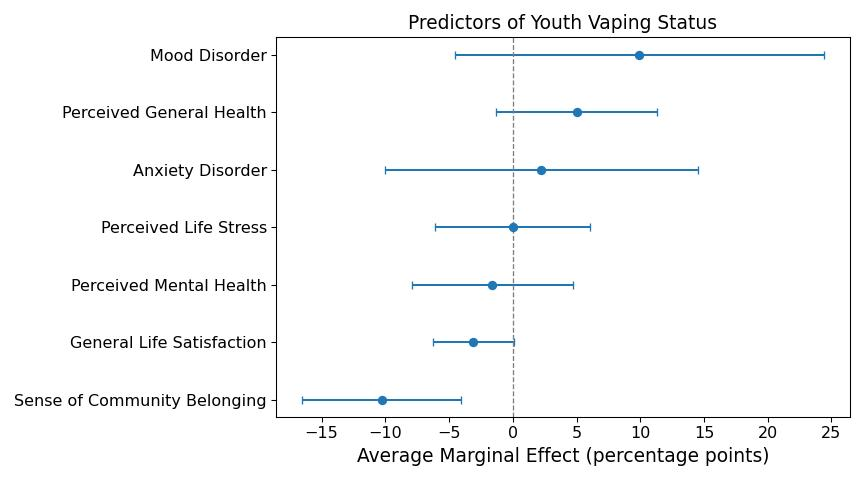

::: {.callout-note}
This page has been updated to reflect the changes made in the November 2026 revision to this project. 

In short, earlier conclusions were backwards: *weaker* belonging was associated with decreases in the likelihood of e-cigarette use. Machine learning approaches have been updated, collinearity concerns corrected, and any causal language for this cross-sectional design removed.

Please see [PR #1](https://github.com/cartermsmith/predictors-youth-vaping/pull/1) on GitHub for details on what's been changed.
:::

## Background

Various factors, like alcohol consumption or cannabis use, have been explored as predictors of youth vaping [(Shi et al., 2022)](https://www.canada.ca/en/public-health/services/reports-publications/health-promotion-chronic-disease-prevention-canada-research-policy-practice/vol-42-no-1-2022/machine-learning-approach-predict-e-cigarette-use-dependance-ontario-youth.html). Yet, might data reflecting the psychological well-being of youth provide insight into other reasons that young people use e-cigarettes? This project examines the relationship between measures of well-being and e-cigarette use among Canadian youth who have tried vaping before.

## Key finding

Analysis uncovered that weaker sense of community belonging was associated with decreases in the likelihood of e-cigarette use in the past month. For every one-unit increase in belonging (getting *worse*), the probability of recently vaping lowers by 10.3 percentage points.

General life satisfaction was marginally related to reductions in past-month use. Each one-point increase (getting *better*) in life satisfaction was associated with a 3.1 percentage point decrease.

To see the relationship between each predictor and the likelihood of recent youth e-cigarette use, see *Figure 1*.

Further, a random forest machine learning algorithm and logistic regression (with `sklearn`) classified current from past e-cigarette users. The models performed modestly above random guessing (AUCs ~.57-.60), suggesting that the measures of well-being held little predictive information for discrimination between these two classes.

## Data Description

This project uses data from the [Canadian Community Health Survey: Public Use Microdata File](https://doi.org/10.25318/82m0013x-eng). The data are from 2022, and are based on reports from over 130,000 people across Canada aged 12+. This project included data from 447 youth respondents aged 12-17 who have tried an e-cigarette in their lives.

## Tools

- SQL: The youth sample was queried from the full microdata file using SQL, via the `duckdb` library. 

- Python: Subsequent cleaning, modelling, and visualization was done in Python (`statsmodels`, `sklearn`, `pandas`, `numpy`, `matplotlib`).

## Limitations

Importantly, these data are cross-sectional, and only suggest that these predictors co-occur with decreases in youth vaping. This snapshot in time means we cannot dissociate cause from effect.

This analysis did not use survey weights, meaning that the conclusions made here apply to the current sample rather than Canadian youth writ large. Sex was not controlled for, while age could not be controlled since it was treated as a broad 12-17 category in the data.

## Next Steps

By themselves, well-being measures do not allow for precise classification of individuals who have kept vaping in the past month. Additional predictors, like the use of other substances, would likely be more helpful for discrimination between individuals.

Speculatively, it's interesting that *weakened* youth sense of belonging is associated with reduced e-cigarette use. This could suggest that e-cigarette use is more common in social settings, perhaps done with friends. The data cannot speak to this directly, but future work exploring this counterintuitive direction might elucidate how peer influence, for instance, shapes vape use.

## Want to learn more?

Check out [this project on GitHub](https://github.com/cartermsmith/predictors-youth-vaping) where you can view a complete technical brief, analysis code, and a guide to reproduce everything for yourself.